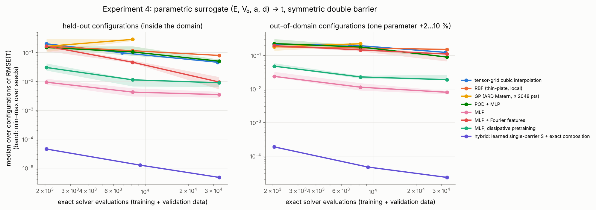

# Quantum Scattering Surrogates

**Physics-informed surrogate modeling and adaptive sampling for quantum resonance reconstruction**

[](https://github.com/Apostal322/kurca4/actions/workflows/ci.yml)

This is reproducible research code from an undergraduate computational-physics coursework project. It compares
the following ways of reconstructing energy-dependent scattering amplitudes from as few exact solver
evaluations as possible, without losing narrow resonances:

* classical interpolation;
* Gaussian processes;
* AAA rational approximation;
* PyTorch neural-network surrogates;
* adaptive sampling.

> **Status:** coursework research code. It is not a peer-reviewed publication. All results come from the
> experiments in this repository, can be regenerated with the commands below, and hold for the systems tested.
> They are not general guarantees.

---

## Contents

[Research overview](#research-overview) · [Main findings](#main-findings) · [Figures](#figures) ·
[Installation](#installation) · [Quickstart](#quickstart) · [Reproducing the research](#reproducing-the-research) ·
[Methodology](#scientific-methodology) · [Project structure](#project-structure) · [Limitations](#limitations) ·
[Documentation](#documentation) · [Citation](#citation)

## Research overview

A scattering calculation is usually repeated for many incident energies and system parameters. Each value requires
an exact ("high-fidelity") solution of the Schrödinger equation. When a single solve is expensive, the natural
question is whether a **surrogate model**, built from a small number of exact evaluations, can reconstruct the
observable. The difficulty lies in **resonances**: narrow peaks that occupy a tiny fraction of the energy range,
carry most of the physics, and are easily missed.

The engineering problem studied here: **reduce the number of expensive simulator calls while preserving the
physically significant features.**

The project addresses the following questions.

1. How many exact solver evaluations are needed for a smooth observable, and for a resonant one?
2. How does reconstruction accuracy depend on the sampling density?
3. Can neural networks (PyTorch MLPs) represent resonant behaviour?
4. When does rational approximation outperform neural networks?
5. Can adaptive (sequential) sampling reduce the cost?
6. When does a surrogate give an actual wall-clock speed-up, not just fewer solver calls?

## Main findings

The findings below come from 1D quantum scattering experiments: rectangular single, double and triple barriers,
asymmetric barriers, and a smooth double-Gaussian barrier. RMSE is the root-mean-square error of the transmission
probability T(E) on a dense, resonance-resolved reference grid.

| # | finding | evidence |
|---|---|---|
| 1 | **Smooth curves need about 10 exact evaluations.** A cubic spline reaches RMSE 6·10⁻⁵ from 10 points, with the textbook convergence orders N⁻², N⁻³, N⁻⁴. A PyTorch MLP plateaus near 10⁻⁴ regardless of N. | Exp. 1 |
| 2 | **On resonant curves, local methods are limited by where the samples are.** Linear, PCHIP and cubic-spline interpolation, GP and MLP all stall at RMSE ≈ 1–2·10⁻² even with 640 uniform evaluations: the narrowest resonance (Γ = 7.5·10⁻³) is never resolved. | Exp. 1 |
| 3 | **AAA rational approximation of the complex amplitude t(k) recovers all resonances from few points.** It needs 15–30 uniform evaluations in 38 systems (resonance widths down to 5·10⁻⁷), and 20–40 in 27 unseen systems (80 when a window contains many poles). On the reference double barrier it reaches RMSE 1.8·10⁻⁷ from 20 points. Mechanism: resonances are poles of the meromorphic function t(k). AAA itself is an established algorithm (Nakatsukasa, Sète & Trefethen, 2018). | Exp. 1, 3, 5 |
| 4 | **The amplitude t is a better target than T = \|t\|².** AAA on T needs about twice as many points (T has mirror-pair poles) and fails for the narrowest widths and at noise 10⁻³. | Exp. 1, 3 |
| 5 | **Adaptive sampling helps local interpolants, but less and conditionally.** Splitting intervals by the change in t solved 15/20 random systems, against 10/20 when splitting by T. The advantage vanishes under some phase conventions. | Exp. 2, 3 |
| 6 | **Measured limits.** A resonance is detectable only if Γ/h clearly exceeds both the data error and the background-approximation error. Under-resolved rational fits are numerically sensitive. The greedy AAA self-stopping rule stopped too early once with 10⁻⁴ data noise. | Exp. 3b, 5 |
| 7 | **In 4D parametric regression, (E, V₀, a, d) → t, the MLP is the best generic method**, at RMSE 3.5·10⁻³ vs 4.6·10⁻² (tensor spline), 8.0·10⁻² (RBF) and 5.0·10⁻² (POD+MLP) at 32k evaluations. Fourier features and dissipative pretraining did not improve it. A **physics-informed hybrid** (learned single-barrier S-matrix + exact composition) is 2–3 orders of magnitude better, at 4.5·10⁻⁵ with 2k evaluations. | Exp. 4 |
| 8 | **Fewer solver calls ≠ faster.** With the fast vectorised solver, no surrogate beats direct computation (MLP training alone takes ~25 s against a 0.012 s scan). With a 4.4 ms/call ODE solver, 30 evaluations + AAA reproduce a 20,001-point scan **670–700× faster** (two measured runs), while the MLP gains only 2.6–3.9×. | cost benchmark |

Negative results are part of the record. The first version of this study over-stated adaptive sampling and missed
the rational-approximation result; several metrics were later found to be wrong and were corrected. See the errata
in [`docs/REPORT.md`](docs/REPORT.md#errata-what-changed-relative-to-the-first-version-of-this-report) and §12.2 of
the Russian report.

## Figures

All figures are produced by the scripts in `scripts/` from the stored experiment results. None of them is a
synthetic illustration. More figures: [`docs/FIGURES.md`](docs/FIGURES.md).

**1. Resonant tunnelling through a symmetric double barrier.** These are the exact transmission probabilities. The
three resonances are quasi-bound states of the well, with widths Γ = 7.5·10⁻³, 8.7·10⁻² and 0.53. At each
resonance T = 1, while between them T ~ 10⁻⁴.


**2. Reconstruction from the same 160 uniform exact evaluations.** Splines, GP and the MLP cannot reproduce the
narrowest resonance (left panel), because no sample falls on it. AAA approximates the complex amplitude t(k) and
infers the pole from the resonance tails.


**3. Error versus number of exact evaluations.** Left: smooth single barrier. Right: resonant double barrier.
Solid lines approximate the complex amplitude; dashed lines approximate T directly.


**4. Parametric surrogate (E, V₀, a, d) → t.** Median error over 40 held-out configurations (left) and 20
out-of-domain configurations (right). The MLP beats the generic interpolators; the structure-exploiting hybrid beats
everything.



## Installation

You need Python ≥ 3.10; the results were produced with Python 3.13. Exact library versions are in
`requirements-lock.txt`. The commands below install the CPU-only PyTorch build, which is all this project needs.

**Linux / macOS**

```bash
git clone https://github.com/Apostal322/kurca4.git quantum-scattering-surrogates
cd quantum-scattering-surrogates
python3 -m venv .venv
source .venv/bin/activate
python -m pip install --upgrade pip
python -m pip install torch --index-url https://download.pytorch.org/whl/cpu
python -m pip install -e ".[dev]"
```

**Windows (PowerShell)**

```powershell
git clone https://github.com/Apostal322/kurca4.git quantum-scattering-surrogates
cd quantum-scattering-surrogates
py -m venv .venv
.\.venv\Scripts\Activate.ps1
python -m pip install --upgrade pip
python -m pip install torch --index-url https://download.pytorch.org/whl/cpu
python -m pip install -e ".[dev]"
```

On macOS, if no CPU wheel is offered from that index, use `python -m pip install torch` instead. The default
PyTorch wheels are larger but work the same way.

## Quickstart

```bash
python -m qscatter.quickstart          # ~30 s; or the console command: qscatter-quickstart
python -m pytest -q                    # 57 tests, ~30 s
```

The quickstart solves the double barrier, reconstructs T(E) from 20 exact evaluations (PCHIP vs AAA), trains a
small PyTorch MLP and writes `quickstart_output/quickstart.png`. Expected output, abbreviated:

```text
[1] exact S-matrix solver: 99001 energies in 0.35 s
    resonance E = 0.993817, FWHM = 7.471e-03, T_peak = 1.000000
    ...
[2] N = 20 exact evaluations: RMSE(T) PCHIP = 8.63e-02, AAA(t(k)) = 1.83e-07
[3] MLP (1-64-64-2, 5000 epochs, ~20 s) on N = 40: RMSE(T) = 4.56e-02
```

Using the library directly:

```python
import numpy as np
from qscatter.physics.potentials import double_barrier
from qscatter.physics.smatrix import compute_scattering
from qscatter.surrogates.rational import RationalAAA

pot = double_barrier(10.0, 0.8, 2.5)          # height V0, barrier width a, well width d
E = np.linspace(0.1, 10.0, 20)                 # 20 exact evaluations
res = compute_scattering(E, pot)               # complex t(E), r(E); res.T, res.R
model = RationalAAA().fit(E, np.column_stack([res.t.real, res.t.imag]))
E_dense = np.linspace(0.1, 10.0, 10_001)
t_hat = model.predict(E_dense) @ np.array([1, 1j])   # reconstructed complex amplitude
print(model.poles())                           # complex resonance poles E_r - i*Gamma/2 (plus background poles)
```

## Reproducing the research

All experiments are deterministic: fixed seeds, `torch.use_deterministic_algorithms(True)`, and CPU execution.
Raw results (JSONL), configurations and figures are written to `results/<experiment>/`. Times are approximate, for
a 4-core CPU.

**Quick checks (minutes)**

| command | what it does | time |
|---|---|---|
| `python -m pytest -q` | 57 unit / physics / regression tests | ~30 s |
| `python scripts/reproduce_key_results.py` | recomputes 17 headline numbers of the report and compares them with the stated values | ~2–4 min |
| `python scripts/audit.py` | independent audit, 10 checks: conservation, analytic and ODE agreement, leakage, counting, reproducibility | ~3–5 min |
| `python scripts/make_physics_figures.py` | physics validation figures | ~1 min |
| `python scripts/benchmark_cost.py` | measured wall-clock cost; run on an idle machine | ~2–3 min |

**Full experiments (hours of CPU time)**

| experiment | run | analyse | approx. time |
|---|---|---|---|
| 1: sample efficiency (984 runs) | `python scripts/run_exp1.py` | `python scripts/analyze_exp1.py` | 1–2 h |
| 1b: MLP early-stopping ablation | `python scripts/run_exp1.py --mlp-no-early-stopping` | `python scripts/analyze_mlp_ablation.py` | ~1 h |
| 2: adaptive sampling (544 runs) | `python scripts/run_exp2.py` | `python scripts/analyze_exp2.py` | ~30 min |
| 3: robustness, 38 systems | `python scripts/run_exp3.py` | `python scripts/analyze_exp3.py` | ~20 min |
| 3b: detectability map | `python scripts/run_exp3b_detectability.py` | `python scripts/analyze_exp3b.py` | ~10 min |
| 4: parametric surrogate | `python scripts/run_exp4.py` | `python scripts/analyze_exp4.py` | ~1.5 h |
| 5: independent stress test, 27 unseen systems | `python scripts/run_exp5.py` | `python scripts/analyze_exp5.py` | ~30 min |

Experiments 1 and 4 are resumable. Configurations, seeds and outputs are documented in
[`docs/EXPERIMENTS.md`](docs/EXPERIMENTS.md).

## Scientific methodology

**Model.** The stationary Schrödinger equation in units $\hbar^2/2m = 1$:

$$-\psi''(x) + V(x)\,\psi(x) = E\,\psi(x), \qquad k = \sqrt{E},$$

where $V$ vanishes outside $[x_L, x_R]$. For a wave incident from the left:

$$\psi = e^{ikx} + r\,e^{-ikx} \quad (x < x_L), \qquad \psi = t\,e^{ikx} \quad (x > x_R).$$

$t(E)$ is the complex transmission amplitude, and $T = |t|^2$, $R = |r|^2$ are the transmission and reflection
probabilities. For real $V$, flux conservation gives $T + R = 1$, and the $2\times2$ S-matrix
$S = \begin{pmatrix} r & t' \\ t & r' \end{pmatrix}$ is unitary.

**Resonances** are poles of the S-matrix at $E_r - i\Gamma/2$. They lie on the unphysical sheet, in the lower half of
the complex $k$ plane. Near an isolated resonance:

$$t(E) \approx t_{\mathrm{bg}} + \frac{c\,\Gamma/2}{E - E_r + i\Gamma/2}.$$

**1D transmission is not a 3D cross section.** $T(E)$ is a dimensionless probability. A 3D experiment measures
$d\sigma/d\Omega = |f(E,\theta)|^2$, with
$\sigma = \tfrac{4\pi}{k^2}\sum_\ell (2\ell+1)\sin^2\delta_\ell$ obtained from radial partial-wave equations. The 1D
model is used because it is exactly verifiable and shares the pole structure; the extension to 3D is outlined, not
implemented. See §2.3–2.5 of the Russian report.

**Reference solver.**
- Each layer's transfer matrix is written with entire functions of $q^2 = E - V$, so it is regular at turning
  points.
- Layers are combined with the Redheffer star product of scattering matrices, which is stable under barriers.
- Exact resonance poles come from Newton iteration on $1/t(E)$ in the complex plane.
- Validation: analytic barrier formula (4·10⁻¹⁵), flux conservation (7·10⁻¹⁴), independent DOP853 ODE integration
  (≤ 3·10⁻¹⁰).

**Surrogates, all compared at equal numbers of exact evaluations.**
- Linear, PCHIP and cubic-spline interpolation.
- Gaussian processes with likelihood-selected kernels.
- AAA rational approximation of $t$ as a function of $k$, with spurious-pole (Froissart doublet) removal.
- PyTorch MLPs: 1→64→64→2 for 1D and 4→128³→2 for 4D, with optional Fourier features, POD+MLP and dissipative
  pretraining.
- A hybrid that learns only the single-barrier S-matrix and composes the double barrier exactly.

**Adaptive sampling.** Interval splitting by the change in $T$, $\log T$ or $t$; GP posterior variance; MLP-ensemble
disagreement; and a greedy rational sampler with a look-ahead error estimate. The greedy rule follows the idea in
the code of Pradovera et al.; their minimal rational interpolation is replaced by AAA because the output here is
scalar.

**Validation methodology.**
- The reference grid is used only for evaluation; a poisoned-reference test verifies this.
- Training, validation and test configurations are disjoint (checked).
- Solver calls are counted by a wrapper, not assumed.
- Repeated seeds with bootstrap confidence intervals.
- A stress test on systems never used during development.
- Wall-clock time is reported separately from solver-call counts.

## Project structure

```text
qscatter/                      Python package (import name)
  physics/                     NumPy/SciPy only, no PyTorch
    potentials.py              piecewise-constant, asymmetric, triple-barrier and staircase potentials
    smatrix.py                 reference S-matrix solver, complex-energy continuation
    analytic.py                textbook single-barrier formulas
    ode_solver.py              independent DOP853 cross-check solver (piecewise and smooth V)
    resonances.py, poles.py    peak/FWHM finding; exact complex poles (Newton on 1/t)
  surrogates/
    baselines.py               linear, PCHIP, cubic spline, Gaussian process
    rational.py                AAA rational approximation of t(k)
    mlp.py                     PyTorch MLP, low-data training protocol, checkpoints with provenance
  parametric.py                4D parametric surrogates (tensor spline, RBF, GP, MLP, Fourier MLP, POD+MLP, hybrid)
  experiments/                 experiment drivers: sample_efficiency, adaptive, robustness, parametric_exp, stress
  data.py, metrics.py, config.py, plotting.py
  quickstart.py                one-minute end-to-end demo (python -m qscatter.quickstart)
scripts/                       run_*/analyze_* for every experiment, audit, cost benchmark, reproduction check
tests/                         pytest suite: physics, surrogates, extensions, regression tests
results/                       raw results (JSONL), designs/datasets, small checkpoints, figures, summary tables
docs/                          reports, supervisor and defence material, provenance, experiment documentation
.github/workflows/ci.yml       CI: ruff, tests, smoke tests on Ubuntu + Windows; scientific reproduction check
```

## Engineering summary (for reviewers and recruiters)

*Reproducible scientific-ML benchmark for reducing expensive simulation calls.* Built a validated quantum-scattering
simulator (NumPy/SciPy, stable S-matrix composition, independent ODE cross-check, 57 tests) and a benchmarking
framework comparing interpolation, Gaussian processes, AAA rational approximation and PyTorch surrogates under equal
simulator budgets. The work covers:

- experiment design with leakage checks, seeds and bootstrap confidence intervals;
- adaptive / active sampling;
- 4D parametric regression;
- error and failure-mode analysis;
- measured end-to-end cost.

Main results:

- A physics-informed representation (rational approximation of the complex amplitude) cut the required
  simulations by 1–3 orders of magnitude compared with every other method tested.
- In 4D, a hybrid physics + learned-component model beat a generic MLP by 2–3 orders of magnitude.
- Solver-call reduction was separated from real speed-up: up to 670–700× with an expensive solver, none with a
  cheap one.

Tools: Python, NumPy, SciPy, PyTorch, scikit-learn, Matplotlib, pytest, GitHub Actions.

## Limitations

* **Mostly one-dimensional.** All results concern 1D finite-range potentials. Nothing is shown for 3D partial-wave
  scattering, Coulomb tails, coupled channels or inelastic scattering.
* **AAA is not our invention.** It is an established, published algorithm. The contribution is its systematic
  evaluation on scattering amplitudes, the choice of representation, and the measured limits.
* **The best method depends on the problem.**
  - Rational approximation wins for 1D energy scans of a fixed system.
  - In 4D parameter space the MLP is the best generic method.
  - A structure-exploiting hybrid wins when the block decomposition is known.
* **Machine learning does not always win.** In 1D the tested MLPs lost to classical methods by orders of magnitude.
  This is a statement about these architectures and tasks, not a theorem.
* **Fewer solver calls do not imply faster computation.** This depends on the cost per call relative to training
  and inference.
* **No general guarantees.** The detectability threshold and the self-stopping rule are empirical. The greedy
  self-certification was premature with noisy data.
* **Statistics.** 3–5 seeds per configuration. Timing varies by 30–50 % between runs on a virtual machine.
* **Literature.** The texts of four 2025–26 papers that motivated parts of the work could not be accessed from the
  development environment. Their methods were implemented from the authors' public code, and two citations remain
  unverified. See [`docs/PROVENANCE.md`](docs/PROVENANCE.md).

## Documentation

| document | contents |
|---|---|
| [`docs/REPORT_RU.md`](docs/REPORT_RU.md) | full coursework report (Russian): physics, derivations, methods, all experiments, errata, references |
| [`docs/SUPERVISOR_BRIEF_RU.md`](docs/SUPERVISOR_BRIEF_RU.md) | two-page brief for the scientific supervisor (Russian) |
| [`docs/DEFENSE_PREPARATION_RU.md`](docs/DEFENSE_PREPARATION_RU.md) | 28 likely defence questions with answers (Russian) |
| [`docs/KEY_FIGURES_RU.md`](docs/KEY_FIGURES_RU.md) | the seven key figures and how to explain them (Russian) |
| [`docs/REPORT.md`](docs/REPORT.md) | English research report with errata |
| [`docs/EXPERIMENTS.md`](docs/EXPERIMENTS.md) | experiment configurations, seeds, outputs, model architectures |
| [`docs/FIGURES.md`](docs/FIGURES.md) | figure gallery |
| [`docs/PROVENANCE.md`](docs/PROVENANCE.md) | published methods vs implementation choices vs new findings; reference verification log |
| [`docs/REPRODUCIBILITY.md`](docs/REPRODUCIBILITY.md) | reproducibility checklist |
| [`results/audit/audit_report.md`](results/audit/audit_report.md) | independent audit of the results |
| [`CHANGELOG.md`](CHANGELOG.md) | project history, including corrected results |

## Citation

If you use this code, please cite it as research software; see [`CITATION.cff`](CITATION.cff). There is no
associated peer-reviewed publication. Cite the original algorithms directly, in particular AAA:
Y. Nakatsukasa, O. Sète, L. N. Trefethen, *The AAA algorithm for rational approximation*, SIAM J. Sci. Comput.
40 (2018) A1494–A1522.

## License

No license has been chosen yet. Until one is added, all rights are reserved by the author. Third-party libraries
keep their own licenses.
