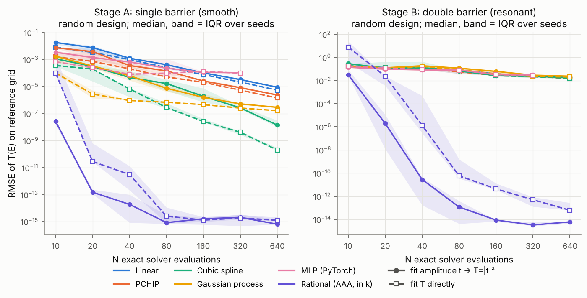
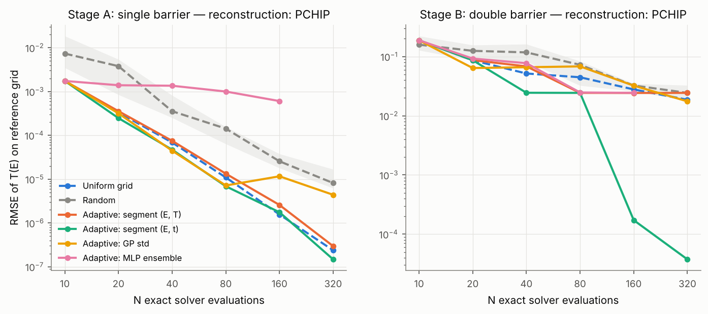
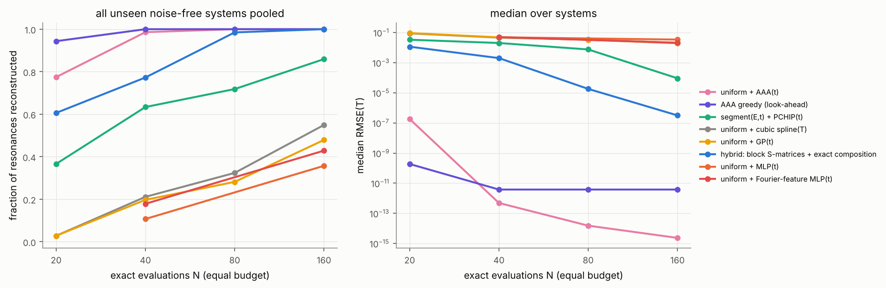
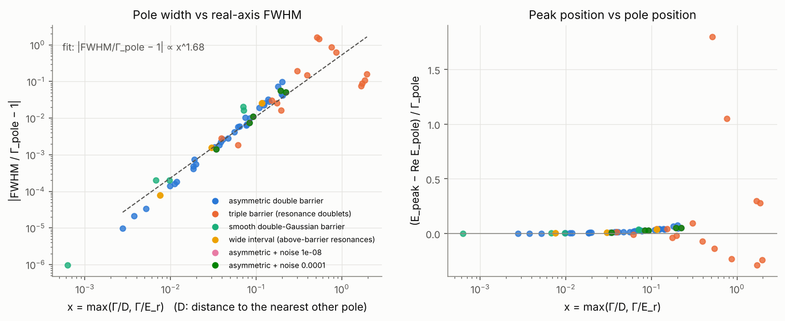

# Figure gallery

Every figure is generated by a script in `scripts/` from stored results. None of them is a synthetic illustration.
The numbering in brackets refers to the Russian report, [`REPORT_RU.md`](REPORT_RU.md).

## Physics validation

| figure | what it shows |
|---|---|
|  | **Single barrier (Fig. 1).** T(E) and R(E) against the textbook formula; deviation at machine precision. |
|  | **Double barrier (Fig. 3).** Three resonances, Γ = 7.5·10⁻³, 8.7·10⁻², 0.53. |
|  | **Resonance line shapes (Fig. 4).** S-matrix solver, Breit–Wigner form and the independent ODE solver. |
|  | **Wavefunction (Fig. 5).** \|ψ\|² on resonance (quasi-bound state, \|ψ\|² ≈ 340 in the well) and off resonance. |
|  | **Complex amplitude and phase (Fig. 6).** The phase jumps by ≈ π at each resonance. |

## Surrogate benchmarks

| figure | what it shows |
|---|---|
|  | **Error vs number of exact evaluations (Fig. 2).** Uniform designs; the amplitude (solid) and T (dashed) as targets. |
|  | **Reconstruction around each resonance with 160 uniform points.** Only AAA resolves the narrow peak. |
|  | **Random designs.** Median and interquartile range over 5 seeds. |
|  | **Where each adaptive strategy places 160 evaluations (Fig. 8).** |
|  | **Adaptive sampling.** Error vs N with PCHIP reconstruction. |
|  | **Robustness to resonance width (Fig. 9).** Γ_min from 2.5·10⁻² down to 5·10⁻⁷. |
|  | **20 random double barriers (Fig. 10).** Fraction of systems solved vs N. |
|  | **Detectability limit (Fig. 11).** Width × noise × N. |
|  | **Parametric surrogate (Fig. 12).** Held-out and out-of-domain configurations. |
|  | **Independent stress test on 27 unseen systems (Fig. 13).** |
|  | **Pole width vs FWHM (Fig. 14).** 73 resonances. |
