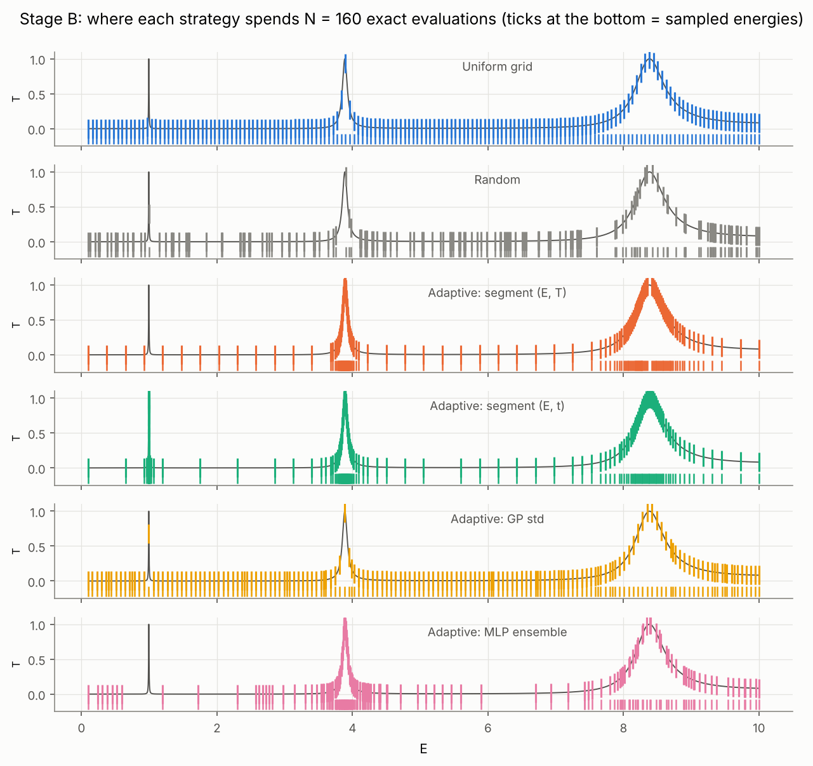
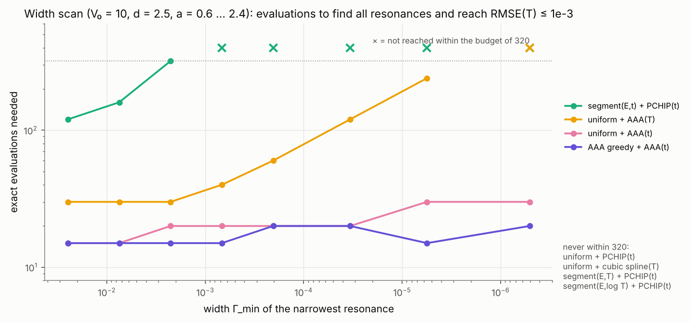
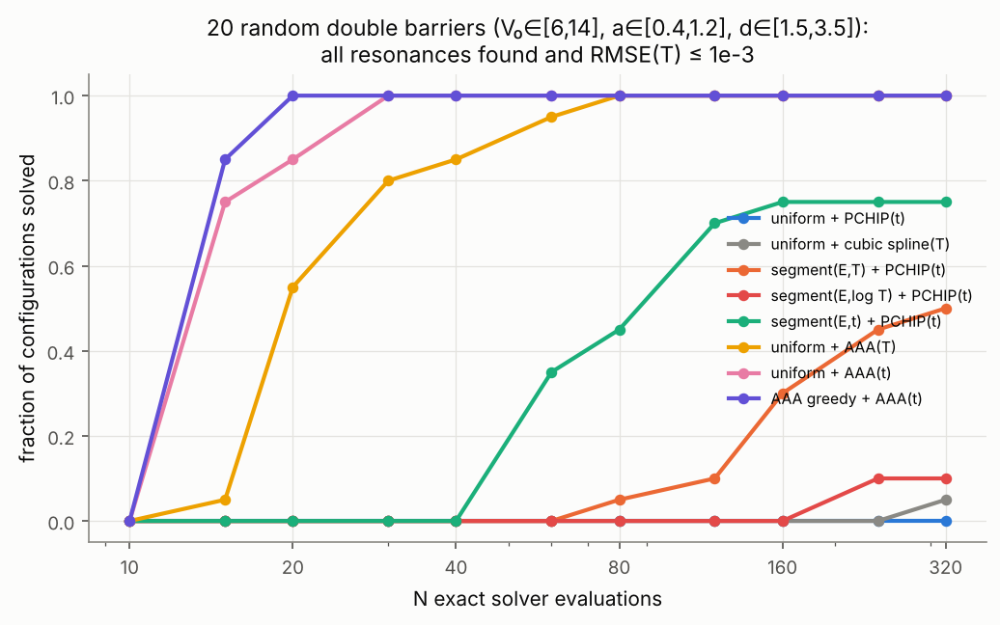
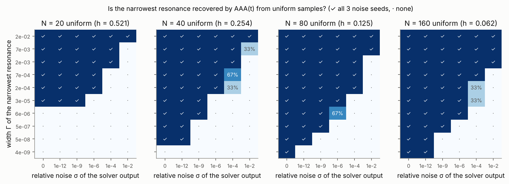

# Surrogate Models for Accelerating Parametric Computations in Quantum Scattering

*Применение суррогатных моделей для ускорения параметрических расчётов в задаче квантового рассеяния*

English research report (portfolio version). The full coursework text in Russian is
[`docs/REPORT_RU.md`](REPORT_RU.md). Every number below is produced by a script in `scripts/`; raw results are in
`results/`; `README.md` lists the commands.

---

## Summary

**Question.** How can the number of expensive exact scattering calculations be reduced while narrow resonances
are preserved? When does machine learning help?

**System.** 1D quantum scattering by piecewise-constant potentials (ħ²/2m = 1). The observables are the complex
transmission amplitude t(E) and T(E) = |t|². There are two test problems: a smooth single barrier, and a
resonant double barrier with resonance widths down to 5·10⁻⁷ in the robustness study. A parametric
extension maps (E, V₀, a, d) → t.

**Reference solver.** Per-layer S-matrices are combined with the Redheffer star product. It is validated against:

| check | agreement |
|---|---|
| textbook barrier formula | 4·10⁻¹⁵ |
| probability conservation (T + R = 1) | 7·10⁻¹⁴ |
| independent DOP853 ODE integration | ≤ 3·10⁻¹⁰ |
| exact complex-plane poles vs. FWHM | consistent, see §3 |

An independent audit with 10 checks passes, including a leakage test with a poisoned reference
(`results/audit/audit_report.md`).

**Main findings.**

1. **Smooth curves.** About 10 exact evaluations suffice. Classical interpolation reaches the
   textbook convergence orders N⁻², N⁻³ and N⁻⁴, and beats a PyTorch MLP by 2–10 orders of magnitude at equal
   budget. The MLP is optimisation-limited at ~10⁻⁴.
2. **Resonant curves: the representation matters more than the sampler or the model class.**
   - Local methods (linear, PCHIP, cubic spline, GP, MLP) on uniform grids all stall at RMSE ≈ 2·10⁻². A
     resonance narrower than the grid spacing is invisible to them.
   - **Rational (AAA) approximation of the complex amplitude as a function of the wavenumber k** works
     because t(k) is meromorphic and resonances are its poles. It recovered every resonance, with RMSE(T) ≤ 10⁻³,
     from 15–30 uniformly spaced evaluations in all 38 systems tested. The narrowest resonance had Γ = 5·10⁻⁷; a
     uniform grid would need ~4·10⁷ points to resolve it.
   - On the original problem, AAA reaches RMSE 1.8·10⁻⁷ with 20 evaluations. Every other method stays above
     10⁻² even with 640.
3. **Self-certification.** A greedy rational sampler with a look-ahead error check certified its own
   convergence in 38/38 systems, with no false certification. At the moment of certification the true error
   was ≤ 2·10⁻¹⁰, or at the noise level.
4. **Adaptive sampling for local interpolants helps, but less and less reliably.** Splitting intervals by the
   change in the complex amplitude beats splitting by T: 15/20 random systems solved vs 10/20. The advantage
   disappears under some phase conventions, so it is an empirical effect, not a guarantee.
5. **Detectability limit.** An unseen resonance can be recovered only if its tail signal Γ/h exceeds the
   larger of the data error and the background-approximation error. The measured detectability map is in §4.4.
6. **Parametric surrogate.** <<EXP4_SUMMARY>>
7. **Cost.** <<COST_SUMMARY>>

### Errata: what changed relative to the first version of this report

| first version claimed | status | evidence |
|---|---|---|
| "On resonant curves the decisive factor is where the solver is evaluated, not the model class"; "an interpolant cannot invent a peak it has not seen" | **Wrong for rational approximation.** It holds only for local methods (splines, GP, MLP). | AAA on t(k) recovers resonances from their analytic tails (§4.2, §4.3). |
| Amplitude-driven adaptive sampling is "the single largest improvement" | **Superseded.** It is a real but secondary, convention-dependent effect. | Exp. 3: 15/20 systems vs 20/20 for AAA; fails with phase reference X = 50 (§4.3). |
| — | The audit found no numerical, leakage or counting errors. The only fix was a pole-extraction detail in the audit itself (spurious Froissart doublets). | `results/audit/audit_report.md` |

---

## 1. Physics and conventions

The model is −ψ'' + V(x)ψ = Eψ with V = 0 outside [x_L, x_R], and k = √E. The wave is incident from the left.
Amplitudes are defined in **one global coordinate**:

  ψ = e^{ikx} + r e^{−ikx} for x < x_L,  ψ = t e^{ikx} for x > x_R,

with T = |t|², R = |r|², and T + R = 1 for real V. An absorbing layer (Im V < 0) gives T + R < 1. Near an
isolated resonance,

  t ≈ t_bg + c (Γ/2)/(E − E_n + iΓ/2),

i.e. a pole at E_n − iΓ/2. The phase of t rises by ≈ π across each resonance.

**T is not a cross section.** One-dimensional transmission is a dimensionless probability with no angular
dependence. A 3D cross section, σ = (4π/k²) Σ (2ℓ+1) sin² δ_ℓ, has the dimension of an area and needs
partial-wave phase shifts from the radial equation. The extension path is in §7.

## 2. Numerical method (summary)

The layer propagator [[cos qd, sin(qd)/q], [−q sin qd, cos qd]], with q² = E − V, is entire in q². It needs no
branch choice and is regular at the turning point E = V. Each layer is converted to a 2×2 S-matrix, and the
layers are composed with the Redheffer star product. Only bounded quantities are multiplied, so the method is
stable for opaque barriers; it refuses to run only above κd > 600. The method is vectorised at 0.63 µs per
energy.

The same formulas continue analytically to complex E. Exact resonance poles are found by Newton iteration on
1/t(E), starting from AAA candidates. The independent ODE solver (DOP853, rtol 10⁻¹¹) shares no algebra with
the S-matrix code. Full details: `REPORT_RU.md` §4.

## 3. Test problems

* **Stage A:** single barrier, V₀ = 5, a = 1, E ∈ [0.1, 12]. T rises monotonically; the first above-barrier
  resonance is at 14.87.
* **Stage B:** symmetric double barrier, V₀ = 10, a = 0.8, d = 2.5, E ∈ [0.1, 10], chosen by a documented
  parameter scan.

| n | E_n (peak) | Γ_n (FWHM) | Re E_pole | −2 Im E_pole | T_peak (S-matrix / ODE) |
|---|---|---|---|---|---|
| 1 | 0.993817 | 7.471·10⁻³ | 0.993797 | 7.470·10⁻³ | 1 − 3·10⁻¹⁴ / 1 − 3·10⁻¹³ |
| 2 | 3.886801 | 8.742·10⁻² | 3.885902 | 8.729·10⁻² | 1 − 1·10⁻¹⁴ / 1 + 1·10⁻¹³ |
| 3 | 8.384040 | 5.319·10⁻¹ | 8.364136 | 5.185·10⁻¹ | 1 − 2·10⁻¹⁵ / 1 + 6·10⁻¹³ |

The pole widths approach the FWHM in the narrow, Breit–Wigner limit. They deviate by 2.5 % for the broad
resonance, where the background makes the line asymmetric.

## 4. Results

### 4.1 Experiment 1: sample efficiency (uniform and random designs; 984 runs)

The full tables, with bootstrap confidence intervals, are in `results/exp1/summary.md` and
`results/exp1/confidence_intervals.md`.

**RMSE of T on the dense reference grid, uniform design:**

| method / target | Stage A N=10 | Stage A N=40 | Stage B N=20 | Stage B N=40 | Stage B N=160 | Stage B N=640 |
|---|---|---|---|---|---|---|
| linear / T | 3.0e-3 | 1.6e-4 | 8.4e-2 | 6.4e-2 | 2.6e-2 | 1.5e-2 |
| PCHIP / T | 2.9e-4 | 3.5e-6 | 8.3e-2 | 6.6e-2 | 2.5e-2 | 1.4e-2 |
| cubic spline / T | 6.2e-5 | 6.5e-8 | 9.0e-2 | 7.5e-2 | 2.5e-2 | 1.4e-2 |
| GP / T | 1.6e-5 | 7.7e-7 | 8.4e-2 | 7.3e-2 | 2.5e-2 | 1.4e-2 |
| MLP / amplitude | 1.4e-3 | 9.8e-4 | 8.3e-2 | 4.5e-2 | 2.8e-2 | — |
| **AAA / amplitude** | **7.0e-9** | **4.8e-16** | **1.8e-7** | **3.2e-12** | **1.5e-14** | **2.4e-15** |
| AAA / T | 7.8e-3 | 1.6e-12 | 1.6e-1 | 8.6e-9 | 8.7e-12 | 3.6e-15 |

* **Fitting T vs fitting the amplitude depends on the method.**
  - For splines, interpolating T is more accurate, because Re t and Im t oscillate with the propagation phase.
  - For rational approximation, the amplitude is better: |t|² has twice as many poles (mirror pairs), so
    AAA(T) needs about twice as many points.
  - Direct fits of T produce unphysical T̂ < 0 or > 1 with the cubic spline and the GP. Shape-preserving PCHIP
    and linear interpolation never do.
* **The MLP is held back by its optimiser and by spectral bias.**
  - It plateaus near 10⁻⁴ on the smooth curve.
  - An ablation without early stopping (`results/exp1_mlp_no_es/summary.md`) removes the non-monotonic
    artefacts of the early-stopping protocol but not the plateau.
  - On the resonant curve it misses even its own training points on a narrow peak: ΔT up to 0.68 after
    20,000 epochs.

### 4.2 Experiment 2: adaptive sampling on Stage B (544 runs)

PCHIP reconstruction of t; RMSE of T:

| strategy | N=40 | N=80 | N=160 | N=320 | resonances found at N=160 | acquisition time |
|---|---|---|---|---|---|---|
| uniform | 5.2e-2 | 4.5e-2 | 2.8e-2 | 1.9e-2 | 2 | — |
| segment (E, T) | 6.8e-2 | 2.4e-2 | 2.4e-2 | 2.4e-2 | 2 | 0.02 s |
| segment (E, t) | 2.4e-2 | 2.4e-2 | 1.7e-4 | 3.7e-5 | 3 | 0.02 s |
| GP posterior std | 6.6e-2 | 6.8e-2 | 3.2e-2 | 1.8e-2 | 3 | 200 s |
| MLP-ensemble disagreement | 7.7e-2 | 2.5e-2 | 2.4e-2 | — | 2 | 390 s |

**Mechanism.** Across a bracket of half-width δ ≫ Γ around an unseen resonance, the resonant term flips sign:
|Δt| ≈ Γ/δ, while ΔT ≤ 2√T_bg · Γ/δ. Exact numbers at δ = 0.069 around E₁:

| | \|Δt\| | ΔT |
|---|---|---|
| across E₁ | 0.107 | 0.0011 |
| same bracket in the background | 0.0037 | 0.0001 |

A stationary GP gets *worse* as a reconstructor on these multi-scale designs (0.10 → 0.19). It has a single
length scale.

### 4.3 Experiment 3: robustness across 38 systems (8,360 runs)

The systems vary along five axes:

* a width scan, a = 0.6…2.4, giving Γ_min from 2.5·10⁻² down to 5·10⁻⁷;
* 20 random double barriers;
* 4 energy intervals;
* 3 phase conventions, t·e^{ikX};
* 3 noise levels, 10⁻¹⁰ to 10⁻³.

The reference uses exact poles. Success means: every resonance found **and** RMSE(T) ≤ 10⁻³.

| method | random systems solved (≤ 320 evals) | median N | max N |
|---|---|---|---|
| uniform + PCHIP(t) | 0/20 | — | — |
| uniform + cubic spline(T) | 1/20 | 320 | 320 |
| segment(E,T) + PCHIP(t) | 10/20 | 160 | 320 |
| segment(E,log T) + PCHIP(t) | 3/20 | 240 | 320 |
| segment(E,t) + PCHIP(t) | 15/20 | 80 | 160 |
| uniform + AAA(T) | 20/20 | 20 | 80 |
| **uniform + AAA(t)** | **20/20** | **15** | **30** |
| **AAA greedy + AAA(t)** | **20/20** | **15** | **20** |

* **Width scan.** AAA(t) needs 15–30 evaluations for every Γ_min down to 5·10⁻⁷. Segment(E, t) + PCHIP fails
  once Γ_min ≲ 7·10⁻⁴.
* **Phase convention.** With reference point X = 50, segment(E, t) fails; AAA needs 30 (uniform) or 60
  (greedy) evaluations.
* **Noise 10⁻³.** AAA(t) still finds every resonance from 15 points and reaches the target at 60. AAA(T) fails.
* **Self-certification of the greedy.** It certified in 38/38 systems, always with true error ≤ 2·10⁻¹⁰ or at
  the noise level, and with all resonances found.

### 4.4 Experiment 3b: when an unseen resonance cannot be detected

AAA(t) on uniform samples, 3 noise realisations per cell:

**Without noise, small N limits detection.**
- With N = 20, resonances with Γ < 3·10⁻⁵ are missed. The tail signal Γ/h is below the error with which 20
  points approximate the background.
- That error falls geometrically with N. N = 40 reaches 5·10⁻⁸ and N = 160 reaches 4·10⁻⁹.

**With noise σ, the limit moves roughly in proportion to σ.** At N = 160, resonances are found down to
Γ ≈ 10⁻⁶ for σ = 10⁻⁶ and down to Γ ≈ 2·10⁻³ for σ = 10⁻².

**Rule of thumb:** detectable when Γ/h ≫ max(data error, background-approximation error). The prefactor is not
universal, so we report the measured map rather than a law.

### 4.5 Experiment 4: parametric surrogate (E, V₀, a, d) → t

<<EXP4_SECTION>>

## 5. Computational cost

<<COST_SECTION>>

## 6. Conclusions

1. **Choose the representation before the model class.** The complex amplitude, treated as a meromorphic
   function of k, combined with rational approximation, reduced the number of exact evaluations for resonant
   observables by 2–3 orders of magnitude compared with every other method, robustly across 38 systems. It
   also provides a reliable self-certifying stopping rule.
2. **Adaptive sampling** is useful for local interpolants, especially when it is driven by the amplitude rather
   than by T. Its gain is smaller and depends on conventions and system parameters.
3. **Neural networks** gave no accuracy advantage in 1D. Where they become competitive in the parametric
   setting, and against what, is shown in §4.5. Structure-exploiting models (S-matrix composition) remained
   superior there.
4. **Solver-call savings are not wall-clock savings** unless an exact evaluation is expensive (§5).

## 7. Limitations and future work

* **Scope of the potentials.** All potentials are 1D and piecewise constant. Meromorphy of t(k) holds for
  finite-range potentials. Long-range (Coulomb) tails change the analytic structure.
* **The fast solver favours direct computation.** For our fast solver, direct computation is cheaper than any
  surrogate. Wall-clock gains appear only with the slow ODE solver.
* **Literature access.** The texts of the four papers the continuation draws on could not be read in this
  environment because the network policy blocked access. Their methods were implemented from the authors'
  public code and abstracts:
  - adaptive rational approximation (Pradovera, Hiptmair & Perugia 2025);
  - greedy active-learning emulators (Giri et al. 2026);
  - dissipative-relaxation transfer learning (Nam, Park & Jang 2026);
  - POD + NN (Dölz & Henríquez).

  Please verify the citation details against the originals.
* **Statistics.** 3–5 seeds per configuration. Confidence intervals are reported, and conclusions are drawn
  only where the differences far exceed the spread.
* **Next steps:**
  - a radial solver for phase shifts δ_ℓ(E), with σ(E) built from surrogates of the partial-wave amplitudes
    e^{iδ_ℓ} sin δ_ℓ, which are meromorphic in k and unitary by construction;
  - parametric rational approximation, i.e. tracking the poles E_n(θ) and Γ_n(θ);
  - unitarity-constrained neural surrogates;
  - reduced-basis / POD methods with residual error estimators once the solver returns wavefunctions.
