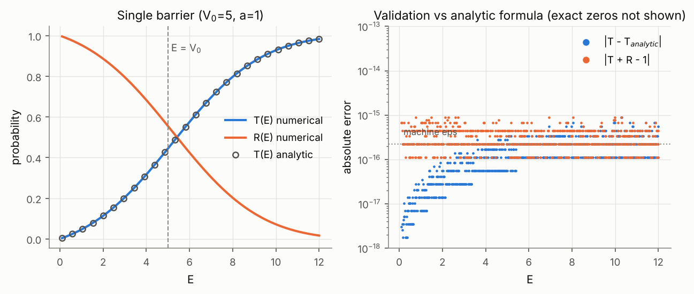
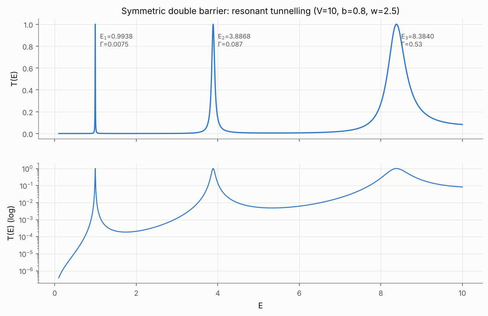
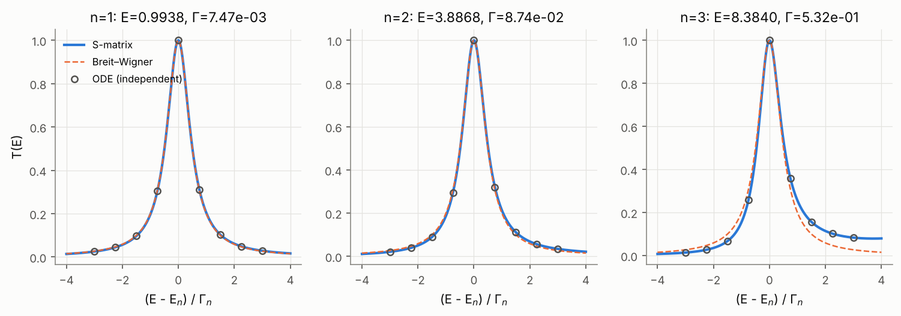
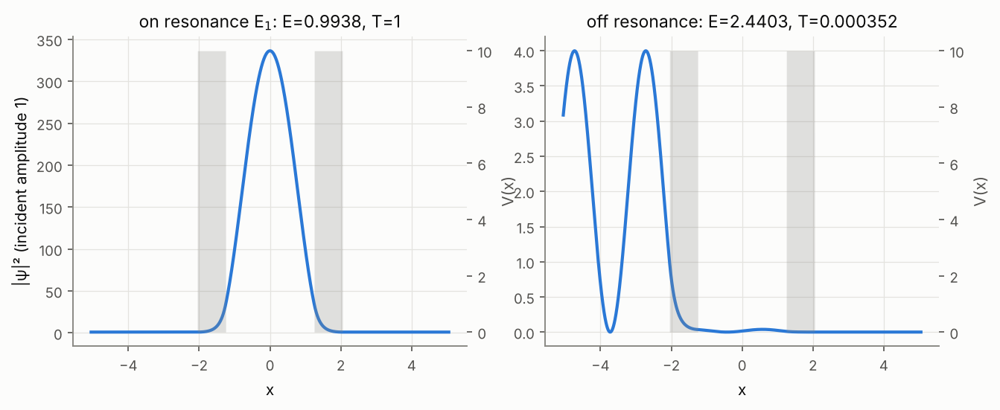
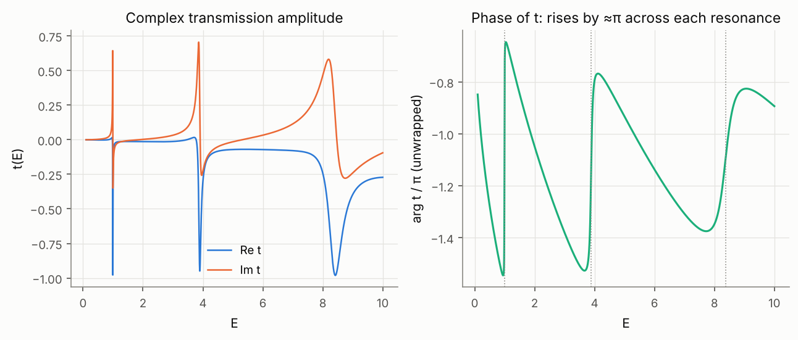
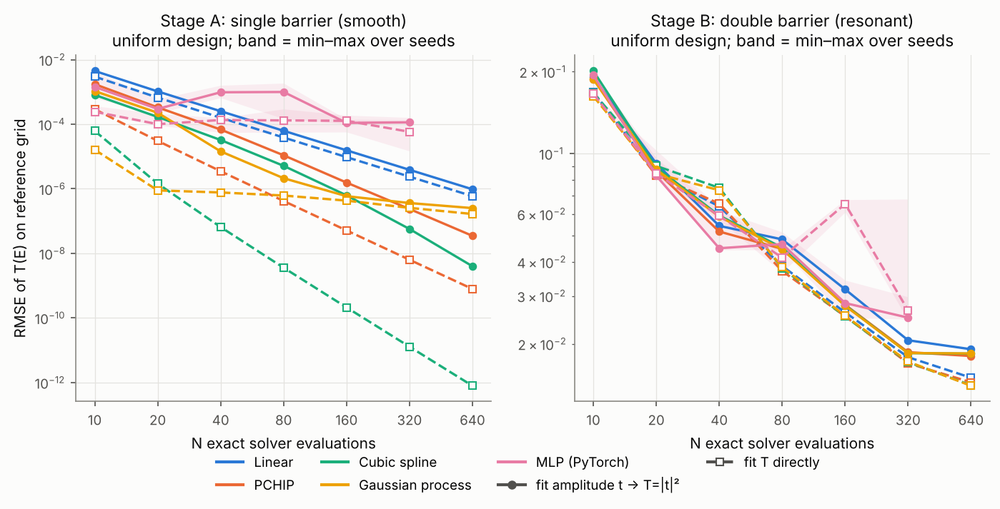
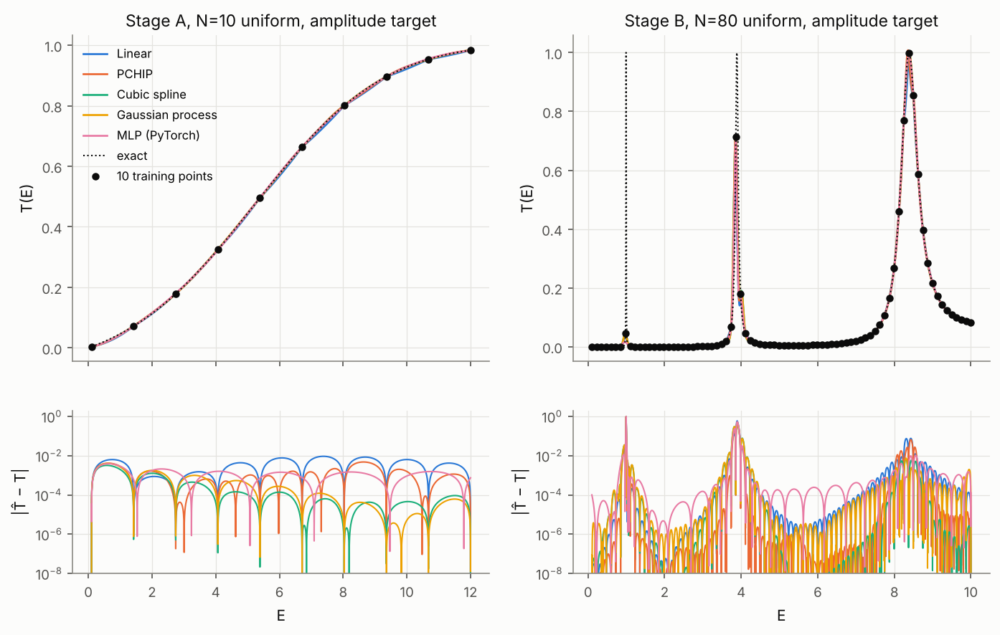
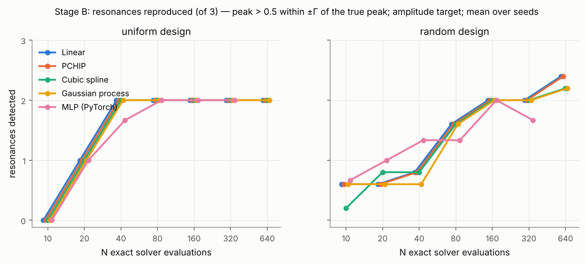
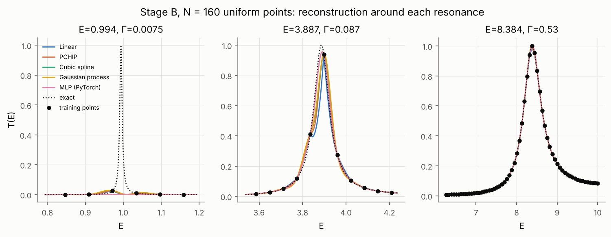

# Surrogate Models for Accelerating Parametric Computations in Quantum Scattering

*Применение суррогатных моделей для ускорения параметрических расчётов в задаче квантового рассеяния*
(provisional title)

Coursework research report — computational physics, 3rd year.
All numbers in this report are produced by the scripts in `scripts/`. The raw data are in `results/`.

---

## Abstract

A scattering calculation is usually repeated on a dense grid of incident energies E. We ask how
many exact solver evaluations are needed to reconstruct the energy dependence of the scattering
observables. We compare classical interpolation (linear, PCHIP, cubic spline), Gaussian-process
regression and a small PyTorch multilayer perceptron, using non-adaptive and adaptive (sequential)
sampling. The test problems are two 1D potentials: a smooth single rectangular barrier and a
resonant symmetric double barrier.

The reference solver composes per-layer scattering matrices. It agrees with the textbook
transmission formula to 1.4·10⁻¹⁵, conserves probability to 7·10⁻¹⁴, and agrees with an
independent ODE integrator to ~10⁻¹¹.

Main findings:

1. **Smooth curve.** Classical interpolation wins clearly. A cubic spline of T(E) reaches
   RMSE 6·10⁻⁵ with only 10 evaluations, and its error falls as N⁻⁴. The MLP stalls at
   ~10⁻⁴, because of optimisation rather than data.
2. **Resonant curve, uniform or random grids.** Every method is limited by sampling, not by the
   model. A resonance narrower than the grid spacing is invisible to all of them. Even 640
   uniformly spaced evaluations miss the narrowest resonance (Γ = 7.5·10⁻³), so RMSE stays
   ≈ 2·10⁻².
3. **Adaptive sampling.** Sampling driven by the *complex amplitude* t(E) resolves all three
   resonances and lowers the error by orders of magnitude at equal cost (see §7). The same
   strategy driven by T(E) alone does worse, because the phase of t carries the resonance
   signal.
4. The neural network brings no measurable accuracy advantage over classical methods in 1D. Its
   possible value lies in higher-dimensional parameter spaces, discussed in §9.

---

## 1. Research questions

| # | Question | Where answered |
|---|---|---|
| Q1 | How many exact evaluations are required to approximate a smooth observable? | §6.1 |
| Q2 | How does the reconstruction error depend on N? | §6.1–6.2 |
| Q3 | Can a PyTorch network learn the complex amplitude t(E)? | §6.3 |
| Q4 | Does ML outperform conventional interpolation? | §6, §9 |
| Q5 | Can sequential data acquisition improve efficiency? | §7 |
| Q6 | Can adaptive sampling reduce the evaluations needed for resonances? | §7 |
| Q7 | When are surrogates useful, and when are classical methods sufficient? | §9 |

We did not assume that machine learning must win. All comparisons use identical point budgets, and
the baselines were configured carefully (see §5.1 for one baseline failure that was found and fixed).

---

## 2. Physical model

### 2.1 Equation, units, conventions

The stationary Schrödinger equation is used in units ħ²/2m = 1:

  −ψ''(x) + V(x) ψ(x) = E ψ(x),   k = √E.

V(x) is piecewise constant and zero outside [x_L, x_R], so the asymptotic potential is the same on
both sides. The wave is incident from the left. The amplitudes are defined with a **common
coordinate x**:

  ψ(x) = e^{ikx} + r(E) e^{−ikx}   (x < x_L),   ψ(x) = t(E) e^{ikx}   (x > x_R).

Then T = |t|², R = |r|², and T + R = 1 for real V.

**Phase convention matters for learning.** In this convention t contains a factor e^{−ik(x_R−x_L)}
relative to amplitudes referenced at the layer edges. The potentials are centred at x = 0 and the
convention is fixed once, in `smatrix.py`. A test checks that the global t does not depend on
where the barrier is placed (`test_single_barrier_analytic_amplitude`). Any choice of convention
changes how fast Re t and Im t oscillate with E, and so how hard they are to interpolate. T is
invariant.

### 2.2 One-dimensional transmission is not a cross section

T(E) is a probability for a 1D wavepacket to pass the barrier. It is dimensionless, lies in [0, 1],
and has no angular dependence. A 3D scattering cross section σ(E) has dimension of area. It comes
from the scattering amplitude f(θ), e.g. through a partial-wave sum

  σ(E) = (4π/k²) Σ_ℓ (2ℓ+1) sin² δ_ℓ(E),

where the phase shifts δ_ℓ come from the radial equation u_ℓ'' + [k² − V(r) − ℓ(ℓ+1)/r²] u_ℓ = 0.
**We never call T(E) σ(E).** The 1D problem is used as an efficient, exactly verifiable prototype.
Resonances appear in it through the same quasi-bound-state mechanism that produces shape
resonances in δ_ℓ(E).

**Planned extension.** The physics package is modular. Potentials, the solver and the observables
are separate, and the surrogate code only sees arrays (E, y). The ODE solver (`ode_solver.py`)
already integrates an arbitrary V(x). A radial solver needs a different boundary condition
(u(0) = 0) and a matching to Riccati–Bessel functions to extract δ_ℓ. The surrogates would then
learn e^{iδ_ℓ} sin δ_ℓ (the partial-wave amplitude, the analogue of t) and form σ(E) from it.
Learning the amplitude rather than the observable is supported by §6.3 and §7.

---

## 3. Reference solver

### 3.1 Method (`qscatter/physics/smatrix.py`)

Within each uniform layer (height V_j, width d_j), the exact propagator of (ψ, ψ') is

  M_j = [[cos qd, sin(qd)/q], [−q sin qd, cos qd]],  q² = E − V_j.

All entries are **entire functions of q²**. This has three consequences:

* no branch of √(E − V) has to be chosen;
* evanescent layers (E < V, q = iκ) need no special case;
* the classical turning point E = V_j is regular. A naive basis e^{±iqx} becomes degenerate
  there.

Each layer is turned into its own 2×2 scattering matrix in the asymptotic medium k:

  t_j = 2ik / (2ik cos qd + q sin qd + k² sin(qd)/q),   r_j = −(α+β)/(α−β), …

The layers are then combined with the **Redheffer star product**:

  t = t_B (1 − r'_A r_B)⁻¹ t_A,  r = r_A + t'_A r_B (1 − r'_A r_B)⁻¹ t_A, …

**Why this is stable.** Multiplying transfer matrices over several layers multiplies growing
factors e^{κd} from different barriers. Their ratios then lose precision. The star product only
ever contains bounded quantities (|S_ij| ≤ 1 for real V). Large numbers cosh κd appear only inside
a single layer, and only in ratios. The solver raises an error before κd > 600, where float64 would
overflow. A 40-unit-thick barrier with κd ≈ 400 still gives finite results that conserve
probability (`test_finite_outputs_opaque_barrier`). No result is clipped anywhere.

The solver is vectorised over energies. It costs **0.63 µs per energy** (`physics_summary.json`).

### 3.2 Independent cross-check (`ode_solver.py`)

The equation is integrated directly with DOP853 (rtol 10⁻¹¹), from x_R (where ψ = e^{ikx}) to x_L.
Each layer is integrated separately, with breakpoints at the discontinuities. The incoming and
reflected waves are then separated at x_L. Integrating leftwards follows the growing branch inside
the barriers, which is the stable direction. This shares **no algebra** with the S-matrix code. It
also provides the wavefunctions. It costs **3.1 ms per energy**, about 5000× slower.

### 3.3 Automated tests and tolerances (`tests/test_physics.py`, 26 tests)

| Test | Criterion | Tolerance |
|---|---|---|
| Free propagation (V = 0, and zero-height layers) | t = 1, r = 0 | 10⁻¹² |
| Single barrier vs. textbook T(E) (incl. sinh branch, E > V₀, wells V₀ < 0) | rel. 10⁻¹⁰, abs. 10⁻¹² | |
| Single barrier complex t vs. closed form, 3 barrier positions | abs. 10⁻¹² | |
| Barrier top E = V₀: T = 1/(1 + V₀a²/4) | rel. 10⁻⁹ | |
| Splitting a layer into 4 sub-layers changes nothing | 10⁻¹¹ | |
| Unitarity T + R = 1 (4 potentials incl. asymmetric and with a well) | 10⁻¹² | |
| Finite outputs for an opaque barrier; invalid input (E ≤ 0, NaN, κd > 600) raises | — | |
| High energy: R ≤ (Born bound)², T → 1 | — | |
| Low energy: T → 0 monotonically | — | |
| Symmetric double barrier: 3 peaks with T_peak = 1, widths increasing with E | 10⁻⁹ | |
| Resonance position/width independent of the scan grid | 10⁻⁶ Γ (position), 10⁻⁹ Γ (width) | |
| Every resonance confirmed by the ODE solver; asymmetric barriers give T_peak < 1 | 10⁻⁸ | |
| S-matrix vs. ODE, 3 potentials × 6 energies, for t and r | 10⁻⁸ | |
| Bit-for-bit reproducibility; the solver call counter is exact | exact | |

Note on the position tolerance. A maximum is ill-conditioned: T ≈ 1 − c(E − E₀)², so E₀ is only
determined to ~√ε·Γ ≈ 10⁻⁸Γ. The half-maximum crossings, and therefore Γ, are well conditioned.
This conditioning is the reason for the 10⁻⁶Γ position tolerance.

A further 18 tests (`tests/test_surrogates.py`) cover the data and model layer: designs, counting
of solver calls, CSV/JSON round trips, exact interpolation of the training data, MLP determinism
and save/load, and the evaluation count of adaptive designs. **Total: 44 tests, ~15 s.**

---

## 4. Physical systems

### 4.1 Stage A — smooth transmission (single barrier)

V₀ = 5, a = 1, E ∈ [0.1, 12], reference grid of 20 001 points.

The first above-barrier transmission resonance lies at E = V₀ + (π/a)² = 14.87, outside the
interval. T(E) therefore rises monotonically from 6·10⁻³ to 0.98 and crosses the barrier top
smoothly.

Maximum error against the analytic formula: **1.4·10⁻¹⁵**. Maximum |T + R − 1|: **1.3·10⁻¹⁵**.
At the barrier top, T(V₀) = 0.444444… = 1/(1 + V₀a²/4) exactly.

### 4.2 Stage B — resonant tunnelling (symmetric double barrier)

The parameters come from a documented scan (`stage_b_parameter_search.py`, see §4.3): barrier
height V = 10, barrier widths b = 0.8, well width w = 2.5, E ∈ [0.1, 10]. The reference grid has
99 001 points (ΔE = 10⁻⁴).

| n | E_n | Γ_n (FWHM) | T_peak (S-matrix) | T_peak (ODE) | reference-grid points per Γ |
|---|---|---|---|---|---|
| 1 | 0.993817 | 7.47·10⁻³ | 1 − 3·10⁻¹⁴ | 1 − 3·10⁻¹³ | 75 |
| 2 | 3.886801 | 8.74·10⁻² | 1 − 1·10⁻¹⁴ | 1 + 1·10⁻¹³ | 874 |
| 3 | 8.384040 | 5.32·10⁻¹ | 1 − 2·10⁻¹⁵ | 1 + 6·10⁻¹³ | 5319 |

**Are the peaks physical rather than numerical artefacts?**

* The independent ODE solver reproduces T = 1 at every peak, to 10⁻¹².
* The positions and widths agree to 10 significant digits across scan grids of 2001 to 400 001
  points (`physics_summary.json → grid_convergence`).
* T_peak = 1 exactly, as required for a symmetric double barrier. An asymmetric version gives
  T_peak < 1 (tested).
* The widths grow with E, as the effective barrier transparency increases. The positions lie just
  below the infinite-well levels (nπ/w)² = 1.58, 6.32, 14.2, shifted down because the well is
  finite, with the expected ordering.
* The narrow resonances are Breit–Wigner (Lorentzian) lines. The broad third resonance becomes
  asymmetric because the non-resonant background rises underneath it (figure below).
* The wavefunction at E₁ is a quasi-bound state with |ψ|² ≈ 340 in the well. Off resonance, the
  wave is reflected (standing wave on the left, |ψ|² ≤ 4).

The phase of t rises by ≈ π across each resonance, on top of a smooth drift caused by the
global-coordinate convention. This becomes important in §7.

### 4.3 Parameter search for Stage B

| V | b | w | resonances in range (E_n, Γ_n) |
|---|---|---|---|
| 10 | 0.5 | 2.0 | (1.36, 9.1·10⁻²), (5.40, 0.83) |
| 10 | 0.8 | 3.0 | (0.74, 4.0·10⁻³), (2.92, 4.3·10⁻²), (6.41, 0.23), (10.9, 1.0) |
| 10 | 1.0 | 3.0 | (0.74, 1.2·10⁻³), (2.93, 1.5·10⁻²), (6.39, 0.11), (10.7, 0.67) |
| **10** | **0.8** | **2.5** | **(0.99, 7.5·10⁻³), (3.89, 8.7·10⁻²), (8.38, 0.53)** |

The chosen configuration has three resonances whose widths span two orders of magnitude, from
narrower than a typical training-grid spacing to very broad. That gives a meaningful "narrow vs
broad" comparison with no artificial features. The data are reproduced by
`scripts/stage_b_parameter_search.py`.

### 4.4 Reference-grid adequacy

The reference RMSE of a fixed surrogate changes by less than 2·10⁻⁵ (relative) when the reference
grid is refined 4× (`results/physics/reference_grid_convergence.txt`). The evaluation metric is
therefore converged.

---

## 5. Surrogate methods

All methods share one interface, `fit(E, Y) → predict(E')`. Two targets are compared:

* **amplitude**: Y = (Re t, Im t), with predicted T̂ = |t̂|²;
* **T**: Y = T directly.

### 5.1 Classical baselines (`surrogates/baselines.py`)

* **Linear** interpolation.
* **PCHIP**: monotone, shape-preserving cubic.
* **Cubic spline**: not-a-knot.
* **Gaussian process** (scikit-learn): inputs scaled to [0, 1] with the known domain,
  standardised outputs, jitter α = 10⁻¹⁰ (noise-free data), one GP per output column. The kernel
  (RBF vs Matérn-5/2) is selected per output by the log marginal likelihood of the *training data
  only*, with 4 optimiser restarts (1 for N ≥ 320, for cost).

**A baseline failure we found and fixed.** In the first runs the GP on Stage B got *worse* with
more data: RMSE 0.20 at N = 160 against 0.05 at N = 40. Inspection showed that the marginal
likelihood had collapsed to the length-scale lower bound of 10⁻⁴, far below the sample spacing. The
GP then interpolated the data with isolated spikes and returned the prior mean in between. A length
scale shorter than the data spacing cannot be identified from the data. The lower bound was
therefore set to half the mean spacing, which uses the training data only. Without this fix the
comparison would have been unfair to the GP.

### 5.2 PyTorch MLP (`surrogates/mlp.py`)

**Architecture:** 1 → 64 → 64 → 2 (amplitude) or → 1 (T), SiLU activations, float64, CPU,
deterministic algorithms, fixed seeds. Input E is mapped linearly to [−1, 1] with the known domain.
Outputs are standardised with the training mean and std, because Re t, Im t and T have different
O(1) ranges. The loss is MSE, with full-batch Adam and cosine learning-rate decay from 10⁻² to
10⁻⁵.

**Low-data training protocol.** A standard random train/validation/test split makes no sense with
N = 10. Instead:

1. Every 5th interior point is held out for validation. The endpoints are always fitted, so the
   network never extrapolates. Interleaving keeps both subsets spread over the interval.
2. Training stops early on the validation loss, with patience 3000. Only epochs ≥ 500 are eligible:
   with 1–2 validation points, a lucky early minimum is likely. This was observed and fixed.
3. The model is **refitted on all N points** for the selected number of epochs, so no exact
   evaluation is wasted.

The dense reference grid is never used for training, early stopping or hyper-parameter selection.

**Configuration selection.** Four settings were compared *by validation loss* on N = 20 and 80,
for both problems (`scripts/mlp_config_selection.py`, `results/mlp_config_selection.txt`):
tanh with lr 3·10⁻³ and 6k epochs; tanh with lr 10⁻² and 20k; SiLU with lr 10⁻² and 20k; and tanh
128-128. The SiLU setting had the lowest validation loss on Stage A and was tied on Stage B. The
reference-grid errors of all four differed by at most ~3×. The conclusions below therefore do not
hinge on this choice.

---

## 6. Experiment 1 — sample efficiency

**Setup.**

* Problems: Stage A and Stage B.
* Budgets: N ∈ {10, 20, 40, 80, 160, 320, 640}. The MLP stops at 320 because of its cost.
* Designs: uniform grid, and random uniform with endpoints included (5 seeds).
* Seeds: MLP seeds 0–2. The uniform design with a classical interpolant or GP is deterministic.
* All 5 methods × 2 targets. **816 runs** (`results/exp1/raw_results.jsonl`).
* Every training set is generated through a counting solver wrapper. Its evaluation count, seed
  and design are stored with the data (`results/exp1/datasets/*.csv/json`).

Full tables: [`results/exp1/summary.md`](../results/exp1/summary.md).

### 6.1 Primary result: error vs. number of exact evaluations

**Stage A (smooth), uniform design, RMSE of T:**

| method / target | N = 10 | N = 40 | N = 160 | N = 640 | order p (RMSE ∝ N⁻ᵖ) |
|---|---|---|---|---|---|
| Linear / T | 3.0e-3 | 1.6e-4 | 9.6e-6 | 5.9e-7 | 2.0 |
| PCHIP / T | 2.9e-4 | 3.5e-6 | 5.1e-8 | 7.9e-10 | 3.0 |
| **Cubic spline / T** | **6.2e-5** | **6.5e-8** | **2.1e-10** | **7.9e-13** | **4.1** |
| Cubic spline / amplitude | 8.1e-4 | 3.2e-5 | 6.3e-7 | 4.0e-9 | 3.1 |
| GP / T | 1.6e-5 | 7.7e-7 | 4.3e-7 | 1.7e-7 | (saturates) |
| MLP / amplitude | 1.4e-3 | 9.8e-4 | 1.1e-4 | — | 0.6 |
| MLP / T | 2.4e-4 | 1.4e-4 | 1.3e-4 | — | 0.2 |

* **Q1.** For the smooth observable, **10 exact evaluations** give RMSE ≤ 10⁻⁴ with a cubic
  spline or GP of T. Twenty evaluations give 10⁻⁶. Uniform sampling with a dense reference costs
  20 001 evaluations, so this is a reduction of more than 1000× for the same visual quality.
* **Q2.** The classical interpolants show their textbook convergence orders: linear 2.0,
  PCHIP ≈ 3, cubic spline 4.1 on T. This confirms both the methods and the evaluation pipeline.
* The GP is the best method at N = 10 (RMSE 1.6·10⁻⁵). It then saturates at ~10⁻⁶–10⁻⁷, a level
  set by the jitter α and the conditioning of the RBF kernel matrix, not by the data.
* The MLP plateaus at ~10⁻⁴ regardless of N. With N = 160 or 320 the training loss stays at
  ~5·10⁻⁷ (in standardised units), so this is the limit of the *optimiser*, not of the data. See
  §6.4 for the early-stopping ablation.

**Stage B (resonant), uniform design.** All methods give practically the same RMSE at each N, and
fall only slowly: 0.19 at N = 10, 0.05 at N = 40, 0.028 at N = 160, 0.018 at N = 640. Every method
is limited by *where* the samples are, not by how it interpolates between them.

### 6.2 Resonances

* The **broad resonance** (Γ = 0.53) is reproduced by every method from N = 40 on. With
  N ≥ 160 the cubic spline places it within 10⁻⁴Γ and gets its width within 10⁻⁴ (relative).
* The **intermediate resonance** (Γ = 0.087) is detected from N = 40 on. The position error falls
  from ~0.3Γ at N = 80 to 10⁻²–10⁻³Γ at N = 320–640.
* The **narrowest resonance** (Γ = 7.5·10⁻³) is *never* reproduced on a uniform grid, even with
  N = 640 (detection criterion: peak > 0.5 within ±Γ).
  * Up to N = 160 the samples nearest E₁ have T ≤ 0.03, so the resonance is simply invisible.
  * At N = 320 and N = 640 the nearest samples have T = 0.27 and 0.38. The grid spacing, 0.031
    and 0.0155, is still 4Γ and 2Γ. The interpolants show a truncated bump of height ≤ 0.38
    instead of a peak of height 1.

  An interpolant cannot invent a peak it has not seen. This one resonance accounts for most of
  the Stage-B error: the RMSE inside resonance windows is ~3·10⁻², the background RMSE
  ~10⁻³–10⁻⁴.
* With random designs, some seeds happen to land near E₁. The mean number of detected resonances
  rises to 2.4 at N = 640. This is luck, not a method.

### 6.3 Amplitude vs. observable (Q3)

* **The MLP can learn the complex amplitude.** Its errors for t (relative L2 10⁻³–10⁻² on Stage A)
  are comparable to its errors for T. On Stage B it reproduces the two resolvable resonances in
  Re t and Im t, which includes the π phase jump.
* **For interpolating a smooth curve, fitting T directly is more accurate.** T(E) is monotonic and
  smoother than Re t and Im t, which oscillate with the propagation phase. Cubic/T beats
  cubic/amplitude by 13× at N = 10, growing to ~5000× at N = 640 (order 4.1 vs 3.1).
* **Physical consistency favours the amplitude.** T̂ = |t̂|² is ≥ 0 by construction. Direct fits
  of T overshoot: cubic/T gives T̂ < 0 or T̂ > 1 in 37 of 84 runs (worst T̂ = −1.1 and 2.0, near
  the narrow resonance), and GP/T in 42 of 84. The amplitude versions only ever exceed 1, and
  less often. No method enforces T ≤ 1, i.e. |t| ≤ 1 (unitarity). PCHIP/T and linear/T never
  produce unphysical values: they are shape-preserving, and that is their advantage. Unphysical
  predictions are reported, not clipped (`summary.md`, last table).

### 6.4 MLP early-stopping ablation

RESULTS_PLACEHOLDER_ABLATION

---

## 7. Experiment 2 — sequential / adaptive sampling

RESULTS_PLACEHOLDER_EXP2

---

## 8. Computational cost

| item | cost |
|---|---|
| S-matrix solver (vectorised) | 0.63 µs per energy |
| ODE solver (DOP853) | 3.1 ms per energy |
| Linear / PCHIP / cubic: fit | ≤ 0.5 ms |
| GP fit (median; kernel selection + restarts) | 0.4–1 s; ~minutes at N = 640 |
| MLP fit (2 × up to 20k Adam epochs) | 13–17 s median, up to ~2 min |
| Prediction on 10⁵ energies | interpolants 1–2 ms; MLP 0.15 s; GP 0.2–0.4 s |

**Honest reading of the cost.** For this 1D piecewise-constant problem the exact solver is
*cheaper than every surrogate*. Evaluating 10⁵ energies exactly takes 63 ms, less than one GP or
MLP fit. Wall-clock "acceleration" is therefore not achieved here, and the project measures cost
as **the number of exact evaluations**. That proxy becomes the true cost when one evaluation
is expensive:

* the ODE solver here is already 5000× slower;
* realistic cases include radial partial-wave solvers with many ℓ, coupled channels, 3D or
  many-body codes, or experiments.

Break-even with the ODE solver: a cubic spline from 40 points (0.12 s of solves) replaces a
20 001-point scan (63 s).

---

## 9. Conclusions (answers to Q1–Q7)

1. **Q1, Q2.** A smooth transmission curve needs very few exact evaluations: about 10 for
   RMSE ≈ 10⁻⁴–10⁻⁵, and 20–40 for ≤ 10⁻⁶. The error follows the expected power laws (N⁻² linear,
   N⁻³ PCHIP, N⁻⁴ cubic spline).
2. **Q3.** Yes. A 2-layer MLP learns Re t and Im t, including the resonant phase jumps it is shown.
   Learning the amplitude makes T̂ ≥ 0 automatic, and it is the natural target for a later 3D
   extension (partial-wave amplitudes → σ).
3. **Q4.** No, not in 1D. At equal budgets the MLP is 1–4 orders of magnitude *less* accurate than
   a cubic spline or GP on the smooth curve, because it is optimisation-limited at ~10⁻⁴. On the
   resonant curve it is no better than linear interpolation. It is also 10⁴× more expensive to
   train. This is the expected result for a 1D, noise-free, smooth regression, where piecewise
   polynomials are near-optimal.
4. **Q5, Q6.** See §7. The decisive factor for resonant observables is **where** the solver is
   evaluated, not the model class. Acquisition based on the complex amplitude finds narrow
   resonances that no uniform grid of up to 640 points resolves.
5. **Q7.**
   * Use classical interpolation for 1D smooth observables and cheap solvers.
   * Use adaptive sampling on the amplitude whenever resonances may be narrower than the planned
     grid spacing.
   * Neural surrogates become attractive when (a) the input is multi-dimensional, e.g.
     T(E; V, b, w) over a potential-parameter space, where splines suffer from the curse of
     dimensionality; (b) one exact evaluation is expensive; and (c) a single amortised model
     must be queried many times, for example in fits to data or uncertainty propagation.

## 10. Limitations and future work

* **1D, piecewise-constant potentials only.** The next steps are the radial solver for phase
  shifts and σ(E) (§2.2), and smooth potentials, which the ODE solver already supports.
* **The surrogate input is E only.** The more realistic case is a surrogate over (E, potential
  parameters), where ML is expected to pay off.
* **No unitarity constraint.** No surrogate enforces |t̂| ≤ 1. An output parametrisation
  t̂ = tanh(·)e^{iφ}, or physics-informed losses, could do so.
* **Single-energy inputs.** Resonance-aware models, such as rational or Padé fits, or
  pole-expansion (Breit–Wigner) features, are a natural, physically motivated alternative to
  generic MLPs and GPs.
* **Seed counts.** 3 seeds for the MLP and 5 for random designs. The spread is shown as bands.
  Conclusions are drawn only where the differences are much larger than the spread.
